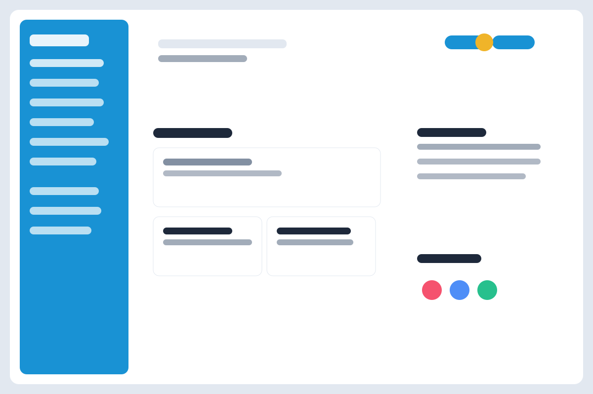

# Admin Dashboard

A polished front-end admin dashboard UI built with plain HTML and CSS. The project demonstrates a modern dashboard layout with a sidebar navigation panel, a top header, project cards, and secondary information panels for announcements and trending topics.

## Preview

## Features

- A professional sidebar navigation with dashboard-style links
- A top header with a search bar, notification icons, user profile, and action buttons
- A grid-based project section featuring multiple cards with descriptive content
- A right-side panel for announcements and trending users
- Responsive layout built with CSS Grid and Flexbox for a clean desktop-first experience

## Project Structure

- index.html — contains the full dashboard structure and content
- style.css — defines the visual design, layout, spacing, colors, and responsive behavior
- screenshots/dashboard-preview.svg — a visual preview image used in this README
- README.md — project documentation and setup instructions

## How to View Locally

You can preview the dashboard in one of these ways:

1. Open index.html directly in your browser, or
2. Start a local web server from the project folder:

   python3 -m http.server 8000

3. Visit http://localhost:8000 in your browser.

## Technologies Used

- HTML5
- CSS3
- Material Design Icons via CDN

## Design Notes

This project is a static front-end build, so it does not require a build step or JavaScript framework. The layout focuses on visual structure, spacing, and a clean dashboard aesthetic.

## Future Improvements

Possible enhancements include:

- Adding interactive navigation and dropdown menus
- Making the layout fully mobile responsive
- Integrating charts and analytics widgets
- Converting the design into a React or Vue component-based UI
